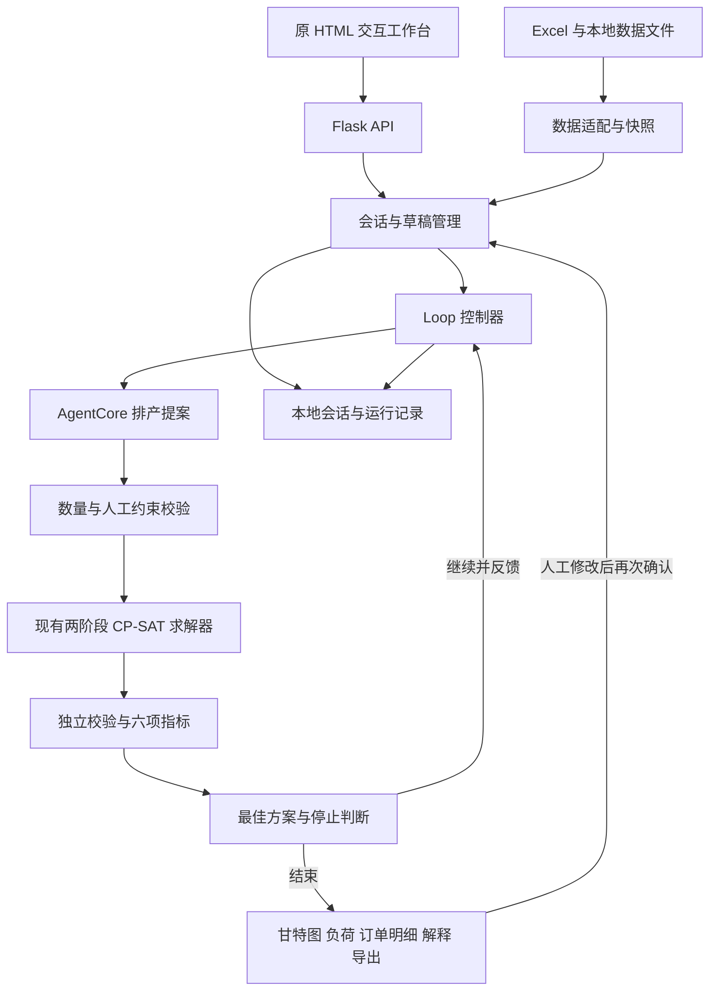

# 饲料 APS 排产智能体设计文档

版本：1.0  
日期：2026-10-18  
设计基线：当前本地 Demo 的源码及用户最新确认的业务口径  
配套文档：[需求文档](需求文档.md)

本文描述当前实现，并单独标注后续扩展。技术对象中的 `quantity`、`phase` 等名称保留源码命名，避免业务名与接口字段混淆。

## 1 总体架构

系统采用本地 Web 工作台、确定性业务后端、远程 Agent 和本地求解器组合。业务状态与循环由本地后端管理；模型只提交受约束的参数提案。



### 1.1 模块分工

以下路径相对 `agent-demo/`，求解器路径例外。

| 模块 | 文件 | 职责 |
|---|---|---|
| Web API | `app.py` | 页面、查询、会话、任务、取消和导出接口；本机请求限制 |
| 数据层 | `data_loader.py` | 读取 Excel，构造需求边界、合法数量选项、班次、电价与换型矩阵 |
| 会话层 | `conversation.py` | 意图执行、当前页面、草稿、上下文指代、历史版本及结果解释 |
| 人工约束 | `planning_state.py` | 数量锁定、位置、停线、优化侧重点校验和约束快照 |
| 循环控制 | `controller.py` | 提案校验、子进程调用、预算、最佳保留、终止与运行落盘 |
| 模型适配 | `agent_worker.py`、`agentcore_client.py` | 读取本地提示词与 Skill，调用 AG-UI 接口，解析流式事件和 JSON |
| 求解适配 | `solver_worker.py` | 将计划转换为原求解器输入，注入 Excel 产能，返回结构化结果 |
| 独立评估 | `evaluation.py` | 校验排程，计算六项指标、需求覆盖率、综合分和库存投影 |
| 需求字段 | `demand_fields.py` | 81 字段目录、来源说明、空值与计算映射 |
| 订单展示 | `order_details.py` | 从运行快照和结果生成原型七列明细，不虚构客户订单 |
| 前端 | `static/app.js`、`demand-table.js`、`production-views.js`、`app.css` | 对话、工作台、数量编辑、字段设置、结果与版本交互 |
| 原算法 | `../aps-feed/aps-feed/aps.py` 与 `scheduler/` | Stage1 分配、Stage2 排序、结果构建 |

当前服务首页为根目录的 `排产智能体平台-前端.html`。原型参考文件为 `agent-demo/reference/排产智能体平台-原始示例.html`。

### 1.2 Agent 的两个用途

1. **意图解析**：常用指令优先走确定性路由；其他表达交给远程模型解析成白名单 action，再由后端执行。
2. **排产优化**：模型接收候选物料、合法数量、指标反馈和人工约束，返回新增量、优先级与优化侧重点。

查询、保存、求解和指标计算均由后端执行。当前没有让模型任意运行代码，也没有在 AgentCore 中部署本地求解器 MCP 服务。

## 2 数据来源与适配

### 2.1 数据输入

| 文件或工作表 | 读取内容 | 使用位置 |
|---|---|---|
| `APS基础数据0814.xlsx / 1-物料数据` | 编号、名称、半成品、包装、生产周期、粒径、工艺、物料组、加药、加色 | 物料关联、换型与显示 |
| `2-供需数据` | 分类、T～T+7 需求、供应、库存上下限、日均销量 | 需求计算、数量选项、供需分析 |
| `3-前置订单数据` | 已有生产订单、计划量、完成量、继续生产量、原产线等 | 固定在制汇总和已有订单信息 |
| `4-上次末生产物料` | 各产线上次末生产物料 | 首任务换型计算 |
| `5-产线数据` | 编号、名称、车间、混合机批量等 | 可用产线与新增量整批约束 |
| `6-产能数据` | 物料与产线对应关系、吨每小时、产线优先级 | 候选产线和生产时长 |
| `车间班次` | 早班、晚班起止时间 | 校验当前支持的连续两班日历 |
| `APS_排产规则汇总表.xlsx` | 规则参考及文件指纹 | 当前没有动态解析该表生成求解约束 |
| `aps-feed/aps-feed/data/v2/1130-3.txt` | 历史电价时段样例 | Demo 谷电计算；不读取其中示例需求替代 Excel |

**规则表当前只参与文件指纹记录，实际规则位于 Python 适配器和原求解器代码。** 修改规则 Excel 不会自动改变算法。后续需建立规则编号、输入字段、校验或求解位置、启用状态和验证用例的对应关系。

### 2.2 标准化与校验

- 物料与产线编号统一为字符串，吨数为数值，内部时刻统一为整数分钟。
- 缺物料主数据或产能的供需项列入排除清单；若被排除项存在实际需求则阻断运行。在制物料不能关联供需和产能时也阻断。
- 当前 4 项排除记录仍包含尚未覆盖的安全库存需求，排除不等于业务上可以忽略。
- 产线车间归属冲突时当前采用产线表，并记录告警。
- 可为空的粒径、销量和展示字段保持空值。部分核心数值读取当前使用空值转 0 的兼容逻辑；正式接入需加强必填和数据类型校验。
- 读取 Excel 使用缓存值，不在 Demo 内执行工作簿公式重算。若数据来源以后包含公式，需确保保存时的公式结果已更新。

### 2.3 班次与时间坐标

生产日 `T` 由用户选择。当前支持且校验的班次为前一日 20:00～当日 08:00、当日 08:00～20:00。

```text
minute 0       = T 前一天 20:00
minute 720     = T 当天 08:00
minute 1440    = T 当天 20:00
实际时刻        = T 当天 00:00 - 4 小时 + minute
```

每条线当前按 1440 分钟可用，不启用额外 2 小时。班次表若不再是上述两个连续区间，适配器报错，不能假设已经支持任意日历。全天停线约束只禁止该线承接任务；不等同分段检修建模。

### 2.4 快照

任务开始时冻结数据、覆盖期、人工约束和来源指纹。一次 Loop 的需求边界不随模型提案改变。指纹包含基础数据、规则表及电价样例文件。

从历史方案恢复时检查与当前来源的兼容性，不把修改后的 Excel 悄悄混入旧版本。历史运行应使用原快照解释和重建明细。

## 3 排产输入输出与数量模型

### 3.1 业务量与内部量

对物料 `p` 定义：

```text
Q[p] = 页面成品分解数量，当前一物料一行，含固定在制余量
W[p] = Excel 固定在制余量
q[p] = 内部新增量 = Q[p] - W[p]
计划产量[p] = Σ 分解行数量，当前等于 Q[p]
```

用户操作使用总量 `Q`。`plan[p].quantity`、Agent 提案的 `quantity` 和 `constraints.quantities[p]` 都使用新增量 `q`，单位为吨。将总量直接写入内部字段会重复计算在制，接口和提示词必须明确这个区别。

在制当前只锁定数量并与同物料新增量合并，不自动沿用前置订单原产线的占用状态。因此当前算法不是完整的车间在制实时续排模型。

### 3.2 合法数量与内部基准

设覆盖需求为 `D`、总供应为 `S`、安全库存为 `L`、库存最大值为 `U`：

```text
D = sum(T 起覆盖天数内的需求)
minimum = max(0, D - S)
页面缺口数量 = -minimum
普通补库类 target = max(minimum, D + L - S)
普通补库类 upper  = max(minimum, D + U - S)
```

新增量必须取可行产线混合机批量的整倍数，并满足数量边界。候选集合为 `options`：

- 对普通补库类，候选量受当前计算的上界限制。
- 非常规2或库存上下限同时为 0 的物料只补缺口，允许最小整批尾差。
- 最低新增量为 0 时可以有 0 候选；没有合法值则报错，不自动放宽约束。
- 内部基准取最小的“不低于 target 的合法量”；若无此量，则取最大合法量。因此补足安全库存是目标，不保证一定达到。
- WIP 不要求整批，新增量必须与最终选择产线的批量相容。

默认覆盖天数为常规1 2 天、常规2 3 天、非常规1 5 天、非常规2 1 天。当前可调整范围分别为 1～2、2～5、3～7、1 天。

基准计划可以提前在内部构造，但前端通过“已人工确认或已生成”的状态控制展示；未填写行不能提前展示为正式计划。

### 3.3 排产参数契约

| 输入 | 核心字段或内容 |
|---|---|
| 需求与供应 | `daily`、`cover_days`、`cover_demand`、`supply`、`wip`、`safety`、`maximum` |
| 合法范围 | `minimum`、`target`、`options`、候选产能和批量 |
| 当前完整计划 | `{product_id: {quantity, priority}}`，quantity 为新增量 |
| 人工约束 | 数量锁定、指定线与时间窗、停用线、固定优化侧重点 |
| 优化目标 | 六项阈值、业务目标文本、剩余预算等配置 |
| 排程反馈 | 上轮指标、约束问题、未排入项、负荷、安全库存不足情况 |

排产输出是合法的完整 `plan`，每物料含新增量与优先级；另有 `focus`、理由与预期效果。它不包含模型猜测的开始结束时间，也不包含模型自报的 KPI。

示意结构如下；数字只说明契约，实际必须从该物料合法选项中选择：

```json
{
  "5000611": {"quantity": 35.2, "priority": 3}
}
```

完整计划必须保留全部需求物料，不能通过删物料提高覆盖率或准交率。`priority` 为 1、2、3，数字越小越优先。

## 4 会话与前端状态

### 4.1 会话状态

| 字段 | 含义 |
|---|---|
| `phase` | 已到达的最远业务阶段 |
| `current_stage` | 用户目前所在阶段，与历史进度分开 |
| `view` | 当前工作台类型、筛选物料等 |
| `plan` | 当前草稿完整计划，数量使用新增量 |
| `constraints` | `quantities`、`placements`、`disabled_lines`、`focus` |
| `dirty` | 当前草稿相对已求解版本有未重算修改 |
| `selected_job_id` | 选中的可行方案版本 |
| `display_job_id` | 当前展示的任务，可用于查看失败或其他结果 |
| `active_job_id` | 正在运行的任务 |
| `versions` | 会话关联的任务版本 |
| `last_product` | 最近定位物料，用于“它”等上下文指代 |

阶段映射为：0 数据校验、1 供需分析、2 目标确认、3 求解调优、4 结果校验、5 方案输出。未开始为 −1。

“返回”“继续”依据 `current_stage`；阶段条根据已到达状态控制可访问范围。在目标页继续只展示目标，启动求解必须使用明确的运行 action。

### 4.2 修改事务

```text
定位物料
→ 总量转新增量
→ 在草稿副本上应用一组修改
→ 校验数量菜单、人工约束及可用产线
→ 全部通过则保存并标记 dirty
→ 有错误则回滚整组修改
```

人工数量锁定通过将该物料的合法数量菜单缩窄为单个值实现，模型提示词之外仍有代码校验。用户指定的 `focus` 优先于 Agent 提案。

求解进行时阻止会改变计划、约束或版本的操作；仍可查询、解释或请求停止。保存草稿不改写已有甘特时间，须明确显示旧版和未重算状态。

### 4.3 字段设置

字段定义集中于 `demand_fields.py`，字段键与中文显示名分离。来源枚举为 `excel`、`computed`、`mapped`、`missing`。

浏览器存储键为 `aps-demand-columns-v2`，用于显隐、排序、冻结与宽度，旧版配置有迁移处理。物料编号和物料默认置左；操作列始终保留。列宽范围 60～600 像素，支持拖动、上下按钮与 Alt 加方向键排序。

字段设置只有确认后写入本地存储，取消不应用。当前偏好属于该浏览器，不是跨设备用户配置。

## 5 Agent 提案与约束边界

本地 `prompts/system.md` 与 `skills/feed-planning/SKILL.md` 在排产调用时读取；`prompts/conversation.md`用于意图解析。用户提供的原流程提示词仅作为业务参考，不直接决定当前后端执行权限。

### 5.1 每轮上下文

为了限制上下文与响应时间，每轮最多提供 8 个可调整候选物料，按轮次轮换。为每个候选提供若干合法数量锚点，以及当前基准值、产能、半成品、粒径和需求边界。完整物料集合仍由后端保留和校验。

反馈来自上一轮，下一次提案所基于的计划来自历史最佳；二者可能不同。上下文通过 `evaluated_round` 和 `base_note` 明确区别，不能将上一轮失败结果当作当前基准。

### 5.2 提案结构

```json
{
  "adjustments": [
    {"product_id": "5000611", "quantity": 35.2, "priority": 3}
  ],
  "focus": "balanced",
  "reason": "说明本次调整依据",
  "expected_effect": "说明希望改善的指标及可能代价"
}
```

`focus` 允许 `balanced`、`setup`、`particle`、`valley`、`delivery`。数量必须通过完整合法菜单和人工锁定校验，未知字段、未知或重复物料、非法优先级、非有限数值等被拒绝。

当前提示约束模型优先使用候选清单和少量调整，但后端并未把“最多 3 项调整”或“只准修改本轮 8 个候选”作为独立硬门槛；真正执行的边界是完整计划合法性与人工约束。若后续需要严格限制搜索邻域，应补齐对应校验。

### 5.3 AgentCore 连接

后端从 `.env` 读取 `AGENTCORE_ENDPOINT` 和 `AGENTCORE_ENDPOINT_API_KEY`，由 `agentcore_client.py` 构造 AG-UI 地址并解析 SSE。不能只以 HTTP 200 判断 Agent 运行成功，还需检查运行结束与错误事件、可用文本和提案格式。

当前连接模块支持运行标识、进度与取消请求。远程停止未确认时不能宣称已停止全部云端工作，也不自动重试可能重复执行的请求。

## 6 求解器实现

### 6.1 排程输入

入口为 `solver_worker.solve(data, plan, focus)`。

| 输入类别 | 内容及转换 |
|---|---|
| 生产任务 | 每物料正总量 `q + W` 合并成一个任务，`recordId` 当前使用物料编号 |
| 物料属性 | 半成品、物料组、粒径、包装、加药、加色及优先级 |
| 产线 | 编号、车间、上次末生产物料、24 小时剩余时长、示例电价 |
| 产能 | Excel 物料与产线组合，产能单位吨每小时 |
| 换型矩阵 | 根据物料属性生成任务间与首任务换型时间 |
| 人工约束 | 指定线、固定开始、最早开始、最晚完成、全天停用线 |
| 优化权重 | 根据 `focus` 选择原求解器权重 |

适配器在独立子进程内替换产能读取函数，使用 Excel 产能而不查询数据库；不会调用原生产系统下达接口。

生产时长按 `ceil(总吨数 × 60 / 产能)` 计算，单位分钟。候选线同时过滤停用、指定线和新增量批量不匹配的组合。

### 6.2 两阶段 CP-SAT

1. **预处理**：准备物料、产线、产能、生产时间和换型关系。
2. **Stage1 分配**：建立任务到候选产线的选择变量，在可行组合、容量、必要任务和人工限制下选择分配；用优先级、均衡及换型等近似项辅助比较。
3. **Stage2 排序**：对已分配任务建立线内前后关系和开始结束时间，计算换型、时间窗、粒径及电价相关目标。原引擎支持按共享混合机分量联合求解；当前 Demo 未提供共享混合机，因此主要按产线独立排序。
4. **结果构建**：返回排入与未排入任务、各产线任务序列、生产与换型时间段及内部评分。
5. **独立复核**：Demo 再按输入数据核验结果并计算六指标，不能只接受求解器“有返回值”。

两阶段是有时间限制的分配加排序，不等同一次完整的全局最优联合求解。Stage2 无可用解时原引擎存在默认顺序回放逻辑，因此独立复核对时间窗、重叠和人工锁定尤其必要。

当前适配器将 Stage1 时间上限设为 8 秒、单工作线程；Stage2 单线一般 5 秒，多线分量 8 秒；外层求解 worker 总上限 65 秒，并受 Loop 剩余总时间约束。这些限制是不同层级，不代表整个任务只需 8 秒。

### 6.3 当前换型函数

不同物料之间，先取以下适用项的最大值，再叠加加药或加色处理时间：

| 条件 | 当前分钟数 |
|---|---:|
| 粒径不同 | 30 |
| 半成品不同 | 20 |
| 二级物料组不同 | 60 |
| 后一物料为禽类且四级物料组不同 | 45 |
| 后一物料非禽类且三级物料组不同 | 60 |
| 任一侧加药或加色 | 在上述最大值上加 20 |

相同物料返回 0。以上为 `data_loader.changeover()` 当前编码，不代表规则汇总表每一项均已映射。缺失粒径在求解适配与指标统计中的处理存在差异：适配输入使用 0，指标对缺失值不参与比较；正式应用需统一缺失属性策略。

### 6.4 优化侧重点

默认权重为物料优先级 200、产线优先级 20、时间窗 400、蛋白 0、粒径 80、换型 100、均衡 200、电价 1。

| focus | 对默认权重的修改 |
|---|---|
| `balanced` | 不修改 |
| `setup` | 换型权重改为 400 |
| `particle` | 粒径权重改为 400 |
| `valley` | 均衡改为 80，换型改为 40 |
| `delivery` | 物料优先级改为 600，时间窗改为 800 |

这些是求解器内部目标权重，与六项指标的外部评分权重不同。当前电耗输入为 0、价格为历史样例，不能据此承诺真实节电收益。

### 6.5 排程输出

原始结果关键字段：

```text
scheduled                         已排入任务集合
unscheduled                       未排入任务
schedule_details[line_id]
  scheduled_products[]
    rid, start_time, end_time, production_time, switch_time
  time_slots[]                    production / switch / idle
scores                            原求解器内部评分
demo_engine, demo_weights         Demo 适配器附加信息
```

吨数主要由冻结 `plan` 与在制数据回关联；原始任务时间记录不能单独充当完整业务订单。用于页面与评估的标准行由 `evaluation.py`构造：

```text
product_id, name, line_id, line_name
new_quantity, wip, quantity
start, end, duration, switch, switch_start
diameter, priority, valid
```

结构化返回链路为 `Aps.production_scheduling()` → `model_build.schedule()` → 结果构建 → worker JSON → Loop。当前已不依赖从控制台日志提取排程结果。

## 7 独立评估与最佳选择

### 7.1 校验

逐任务检查物料集合、数量合法性、任务重复或拆线、产能、整批、停用线、指定线、时间窗、生产时长、换型、重叠和开班窗口。未排入的计划计入问题，不能从分母移除。

固定必需集合取 `minimum > 0` 或 `wip > 0` 的物料；必须按时完成且新增量覆盖最低需求。该集合用于 `hard_coverage`，避免提案通过少排必须任务取得高分。

`eligible` 需同时满足：无输入错误、无无效或缺失任务、计划非空、固定必需集合全部覆盖。

### 7.2 指标接口

六项指标键为 `feasibility`、`particle`、`delivery`、`oee`、`balance`、`valley`。每项包含 `name`、`value`、`numerator`、`denominator`、`note`；`value` 以 0～100 的百分数表示，但均衡原始值可为负，分母为 0 时为 `null`。

具体公式与默认阈值见[需求文档第 6 节](需求文档.md#6-六项指标与优化目标)。特别注意：

- 理论 OEE 的分母是各有任务产线从窗口起点到末任务结束的跨度，包含等待与换型，不是全厂 7×24 小时。
- 均衡按固定七条线的生产负荷计算，空闲线参与；标准差使用总体标准差。
- 谷电分母保留七条线的谷电可用时长。全天停线当前不缩小这个分母，避免通过改统计范围提高指标；生产应用是否调整需业务确认。
- 及时交付当前统一截止 1440 分钟，订单明细仍显示实际交期缺失，二者不能混用。

### 7.3 评分与排序

```text
软分 = 加权平均(clamp(适用指标值, 0, 100))
权重 = 粒径 0.2、交付 0.3、OEE 0.2、均衡 0.2、谷电 0.1
排序键 = (eligible, hard_coverage, feasibility, score)
```

空值指标不参与软分，其余权重重新归一化。采用上述字典序比较，软分不能抵消硬约束问题。若所有候选均不满足门槛，仍可保存最好的诊断候选，但不得标为可执行方案。

原求解器 `scores` 与 Demo `evaluation.score` 不是同一套分数；Loop 使用后者及硬门槛。

## 8 Loop 控制器

### 8.1 主流程

```text
冻结输入并校验人工约束
base = 用户草稿或内部基准
best = 空；previous = 空；stale = 0

逐轮执行，最多 max_rounds：
    检查取消与总预算
    对话入口第一轮：保持确认后的计划
    其余 Agent 轮：根据 base 和 previous 反馈请求提案
    若用户固定 focus，用用户值覆盖提案 focus
    校验完整计划与锁定约束
    非法则记录 rejected，累计停滞并按上限停止或继续
    若计划及 focus 与已求解候选重复则停止
    调用求解器，独立评估
    根据排序键更新 best
    根据硬表现改善或最小分数提升判断是否重置 stale
    保存本轮、原始排程和最佳轮号
    previous = 本轮；base = best.plan
    若为 baseline 模式、全部适用阈值达成或停滞达到上限则停止

返回最佳结果、全部记录和停止原因
```

默认配置与允许范围见需求文档第 7 节。阈值达成采用“方案可行 AND 所有适用指标达到阈值”；停止条件之间采用 OR。

### 8.2 入口差异

| 入口 | 第一轮行为 |
|---|---|
| 对话或界面确认求解 | 传入 revision 草稿，先求解确认后的完整计划，后续才调用排产 Agent |
| 直接 `POST /api/jobs`，mode 为 agent | 无 revision，第一轮即调用 Agent 提案 |
| mode 为 baseline | 固定规则或草稿基准，仅求解一轮，不调用排产 Agent |

因此界面最大轮数 1 表示基准验证，不表示已经完成 Agent 反馈优化。自然语言意图解析可能独立调用模型，与排产轮次不是同一计数。

### 8.3 时间预算与异常

- 单次排产 Agent worker 上限 240 秒；内部接口读取超时配置为 180 秒。
- 单次求解 worker 上限 65 秒；各 worker 实际截止时间取单次上限与总预算剩余时间的较小值。
- 自然语言意图解析另有约 60 秒调用上限，不属于排产 Loop 轮次。
- 取消或超时时终止本地子进程，并尝试停止云端运行；清理和网络停止确认可能产生少量额外耗时，预算不是硬实时 SLA。
- 提案格式或数量拒绝可以继续下一轮；调用或求解异常则记录失败并结束，已有结果保留。
- 服务重启把未结束任务标为中断，不自动续跑。当前管理器同时只允许一个活跃优化任务。

### 8.4 修改后新版本

新任务保存 `parent_job_id` 和用户草稿，人工数量成为硬锁定。新一轮的最佳候选从空开始，只比较本次问题的结果。旧版本只用于溯源和对比，不能直接沿用其分数作为修改后候选。

## 9 结果展示与持久化

### 9.1 订单明细适配

`order_details_for(data, result)` 按物料聚合该轮真实结果，并对正计划量物料生成展示行。当前订单号 `order_number` 和交付 `delivery` 为 `null`，由前端显示“—”。

| 状态 | 当前判断 |
|---|---|
| 未排入 | 没有该物料的排程行 |
| 待检查 | 排程行未通过校验或排入量大于计划量 |
| 部分排入 | 有排程行，但合计量小于计划量 |
| 已排入 | 合计量匹配且相应行通过校验 |

适配器可以合并多个同物料行用于未来扩展，但当前求解校验仍拒绝拆线重复任务。这不代表已实现多行求解。

### 9.2 文件结构

```text
agent-demo/
  .env                         Endpoint 与 API Key，仅后端读取
  sessions/<session_id>.json   对话、草稿、配置、约束、版本关联
  runs/<job_id>/
    snapshot.json             冻结的数据与来源指纹
    job.json                  状态、各轮提案与评估、最佳轮、停止原因
    solver-<round>.json        原求解器结构化结果
    progress-<round>.json      Agent 运行进度
```

求解结果经订单展示适配后再返回前端，不需要伪造客户订单落盘。浏览器列偏好与服务端会话分开保存。当前为文件持久化，尚不提供多人事务、集中权限和数据库级审计。

## 10 HTTP 接口

基础地址：`http://127.0.0.1:8765`。POST 请求使用 `Content-Type: application/json`。

| 方法 | 路径 | 用途与主要输入 |
|---|---|---|
| GET | `/api/health` | 本地服务健康；不代表云端 Agent 连通性已经验证 |
| GET | `/api/bootstrap` | 默认配置、指标目录、81 字段、数据摘要、是否已配置 Agent |
| GET | `/api/dataset` | 需求列表、排除项、告警和假设 |
| POST | `/api/sessions` | 新会话；可传 `config` 或用于载入的 `job_id`；成功 201 |
| GET | `/api/sessions` | 会话列表 |
| GET | `/api/sessions/{id}` | 当前会话、视图、版本和任务状态 |
| POST | `/api/sessions/{id}/messages` | 提交 `text` 或白名单 `action`；返回更新后的会话展示结构 |
| POST | `/api/jobs` | 直接启动任务，输入 `config`、`goal`；成功 202 |
| GET | `/api/jobs/{id}` | 轮询任务、轮次、评估及生成的 `order_details` |
| POST | `/api/jobs/{id}/cancel` | 请求停止；请求体可为 `{}` |
| GET | `/api/history` | 本地计算历史 |
| GET | `/api/jobs/{id}/export/csv` | 导出任务最佳轮的排程行，标明可行或候选状态 |
| GET | `/api/jobs/{id}/export/json` | 导出任务记录，包括各轮信息 |

推荐业务工作台使用会话接口，使对话、数量草稿和人工约束共同进入 revision。直接 jobs 接口用于独立计算，不替代会话修改流程。

### 10.1 请求示例

新建会话：

```http
POST /api/sessions
Content-Type: application/json

{}
```

查询：

```json
{"text":"查询5000611的需求"}
```

修改单个物料的总量，以下数值需以实时合法菜单为准：

```json
{
  "action": {
    "type": "quantity",
    "product": "5000611",
    "quantity": 35.2,
    "kind": "total"
  }
}
```

确认求解：

```json
{"text":"确认目标，开始求解"}
```

表格批量保存可使用 `action.type = edit`，在 `changes` 数组提交数量或位置修改；运行前仍需经过完整事务校验。结果字段以实际接口为准，本文示例不是独立新增 API。

### 10.2 错误处理

当前常见 HTTP 状态为：格式或参数错误 400、本机或来源限制 403、不存在 404、无可导出结果 409、非 JSON POST 415。

会话中的业务修改拒绝通常仍返回 HTTP 200，并在消息中说明“未应用”。因此前端不能仅以 200 判断修改成功。后续应增加明确的 action 执行结果与错误码，避免依赖自然语言文本。

## 11 启动与验证

在 APS 根目录运行：

```powershell
powershell -ExecutionPolicy Bypass -File .\agent-demo\start.ps1
```

打开 `http://127.0.0.1:8765/`。也可使用根目录的 `启动APS Demo.cmd`。默认绑定 `127.0.0.1`，API Key 只在 `agent-demo/.env` 中填写。

当前依赖包括 Flask 3.1.2、openpyxl 3.1.5、OR-Tools 9.10.4067，完整版本见 `agent-demo/requirements.txt`；使用独立 `.venv`，避免改变原求解器运行环境。

现有验证入口：

```powershell
# 单元与业务校验
agent-demo/.venv/Scripts/python.exe -m unittest discover -s agent-demo/tests -v

# 真实求解器基准检查
agent-demo/.venv/Scripts/python.exe agent-demo/smoke_run.py

# 真实 Agent 加求解器检查，会调用已配置云端 API
agent-demo/.venv/Scripts/python.exe agent-demo/smoke_run.py --agent --rounds 2

# 服务启动后的对话修改与重排验证
agent-demo/.venv/Scripts/python.exe agent-demo/check_conversation.py
```

这些是可复用检查入口；本次文档生成没有重新运行全部测试、求解或云端调用。业务验收以需求文档 AC01～AC14 为清单，还需覆盖数据异常、非法修改、取消、失败恢复和多版本结果一致性。

## 12 后续开发与迁移

### 12.1 当前边界

当前无客户逐单交期、分段不可用日历、原料齐套、共享混合机关系、蛋白等级和真实电价电耗等完整生产数据。已提供的班次已使用，不应再次列为缺失。

现有系统不能据此宣称完整生产可执行性、真实订单准交率或节约电费。也未提供正式 APS 下达、跨线分解求解、多用户权限和生产级任务调度。

### 12.2 建议开发顺序

1. **固化业务契约**：确认总量与在制关系、拆分要求、指标分母及规则映射；为变更补齐验收样例。
2. **补充结构化接口结果**：为修改成功或失败、任务错误、求解回退提供机器可识别状态。
3. **接入真实业务数据**：分别替换客户订单、库存、日历、电价等适配层，保持计划与评估契约稳定。
4. **按需扩展多行分解**：引入独立 `decomposition_id`，保存每行物料、数量、产线及时间约束；修改求解、校验、计划汇总和订单关联。
5. **迁移运行环境**：把本地业务工具和求解器封装为服务，再接入 AgentCore；验收相同输入下的约束与指标一致性。
6. **最后接入正式下达**：明确接口、审批边界、幂等、回执与失败重试，防止重复生产指令。

### 12.3 Skill 与 MCP 的迁移职责

以下为迁移建议，当前没有部署：

| 内容 | 建议迁移方式 |
|---|---|
| 排产知识、提案格式与业务解释原则 | 整理本地提示词和排产 Skill，配置到选定的云端 Agent |
| 查询需求、校验计划、执行求解、评估、读取结果 | 封装为受控 HTTP 服务或 MCP 工具，复用现有确定性代码 |
| Loop 最大轮数、时间、停止、最佳保留 | 继续由可测试的控制器执行，不能只写在提示词里 |
| 持久化与并发 | 将本地 JSON 升级为数据库与任务队列，增加用户、权限、版本和审计 |
| 求解运行 | 保留独立进程或容器，固定依赖，设置超时与资源限制 |
| 凭据 | 云端凭据配置与最小权限，前端仅访问业务后端 |

候选工具可命名为 `query_demand`、`validate_plan`、`solve_schedule`、`evaluate_schedule`、`get_run_result`。这是建议的服务边界，不是当前已存在的 MCP 名称。正式接入时以平台提供的工具协议和鉴权方式为准。

## 13 源码索引

- [数据与数量规则](../agent-demo/data_loader.py)
- [会话流程](../agent-demo/conversation.py) 与 [人工约束](../agent-demo/planning_state.py)
- [Loop 控制器](../agent-demo/controller.py) 与 [独立评估](../agent-demo/evaluation.py)
- [求解适配](../agent-demo/solver_worker.py) 与 [原算法入口](../aps-feed/aps-feed/aps.py)
- [Stage1 分配](../aps-feed/aps-feed/scheduler/stage1_assign.py) 与 [Stage2 排序](../aps-feed/aps-feed/scheduler/stage2_ordering.py)
- [字段目录](../agent-demo/demand_fields.py) 与 [订单明细适配](../agent-demo/order_details.py)
- [Web API](../agent-demo/app.py) 与 [部署说明](../agent-demo/README.md)

## 附录 81 字段目录

下表来自当前 `demand_fields.py`，用于研发定位。序号对应字段目录，不表示固定页面顺序；页面默认把物料编号、物料放到最左，并按用户确认的配置展示。

“计算”仅表示字段值由代码构造，并不代表全部只读；成品分解数量仍是人工编辑对象。当前缺失字段保留列定义并显示“—”。

| 序号 | 字段 | 字段键 | 来源 |
|---:|---|---|---|
| 1 | 订单需求量 | `order_demand` | 映射 |
| 2 | 计划产量(吨) | `plan_quantity` | 计算 |
| 3 | 产品分类 | `category` | Excel |
| 4 | 订单需求截止日期 | `due_date` | 缺失 |
| 5 | 缺口数量 | `shortage` | 计算 |
| 6 | 继续生产量(吨) | `wip` | Excel |
| 7 | 物料编号 | `id` | Excel |
| 8 | 成品分解数量(吨) | `decomposed_quantity` | 计算 |
| 9 | 建议生产量(吨) | `suggested_quantity` | 计算 |
| 10 | 未来订单需求量 | `future_order_demand` | 映射 |
| 11 | 物料 | `name` | Excel |
| 12 | 库存数量 | `stock` | 计算 |
| 13 | 库存最小值 | `safety` | Excel |
| 14 | 库存最大值 | `maximum` | Excel |
| 15 | 配料半成品 | `semi` | Excel |
| 16 | 备注 | `remark` | 缺失 |
| 17 | 生产订单号 | `order_ids` | Excel |
| 18 | 成品分解次数 | `decomposition_count` | 计算 |
| 19 | 待生产量(吨) | `pending_quantity` | 计算 |
| 20 | 排产优先级 | `line_priority` | Excel |
| 21 | 车间 | `workshop` | 计算 |
| 22 | 产线 | `line` | 计算 |
| 23 | 订做料 | `custom_product` | 缺失 |
| 24 | 总需求量 | `total_demand` | 计算 |
| 25 | 提货需求量 | `pickup_demand` | 缺失 |
| 26 | 未来提货需求量 | `future_pickup_demand` | 缺失 |
| 27 | 手工备货量 | `manual_stockup` | 缺失 |
| 28 | 拼单需求量 | `combined_demand` | 缺失 |
| 29 | 未来拼单需求量 | `future_combined_demand` | 缺失 |
| 30 | 总供应量 | `supply` | Excel |
| 31 | 冻结库存量 | `frozen_stock` | 缺失 |
| 32 | 当日已排产量 | `scheduled_quantity` | 计算 |
| 33 | 最低生产量 | `min_quantity` | 计算 |
| 34 | 最高生产量 | `max_quantity` | 计算 |
| 35 | 参考日均销量 | `reference_sales` | 映射 |
| 36 | 去年同期销量 | `last_year_sales` | 缺失 |
| 37 | 上月同期销量 | `last_month_same_sales` | 缺失 |
| 38 | 当月日均销量 | `month_daily_sales` | 缺失 |
| 39 | 前7日总销量 | `sales_7_total` | 计算 |
| 40 | 前7日日均销量 | `sales_7_daily` | Excel |
| 41 | 前3日总销量 | `sales_3_total` | 缺失 |
| 42 | 前3日日均销量 | `sales_3_daily` | 缺失 |
| 43 | 上月销量汇总 | `last_month_total` | 缺失 |
| 44 | 本月实际销量 | `month_actual` | 缺失 |
| 45 | 本月销售预测 | `month_forecast` | 缺失 |
| 46 | 物料组（三级） | `group3` | Excel |
| 47 | 物料组描述 | `group_description` | 缺失 |
| 48 | 产品组 | `product_group` | 缺失 |
| 49 | 生产周期 | `cycle` | Excel |
| 50 | 最近生产日期 | `last_produced_at` | 缺失 |
| 51 | 最近生产数量 | `last_produced_quantity` | 缺失 |
| 52 | 生产仓储地点 | `warehouse` | 缺失 |
| 53 | 理论环模 | `die` | 缺失 |
| 54 | 生产粒径 | `diameter` | Excel |
| 55 | 开孔率(%) | `open_ratio` | 缺失 |
| 56 | 长径比 | `aspect_ratio` | 缺失 |
| 57 | 供应类型 | `supply_type` | 缺失 |
| 58 | 包装类型 | `package` | Excel |
| 59 | 前置订单 | `preceding_orders` | Excel |
| 60 | 生产计划号 | `plan_number` | 缺失 |
| 61 | 核心生产需求 | `core_demand` | 计算 |
| 62 | 补库生产需求 | `replenishment_demand` | 计算 |
| 63 | 需求管理方式 | `demand_management` | 映射 |
| 64 | 补库策略 | `replenishment_strategy` | 映射 |
| 65 | 补库标识 | `replenishment_flag` | 计算 |
| 66 | 指导开工时间 | `planned_start` | 计算 |
| 67 | 指导完工时间 | `planned_end` | 计算 |
| 68 | T订单需求量 | `day_demand_0` | 映射 |
| 69 | T+1订单需求量 | `day_demand_1` | 映射 |
| 70 | T+2订单需求量 | `day_demand_2` | 映射 |
| 71 | T缺口 | `day_gap_0` | 计算 |
| 72 | T+1缺口 | `day_gap_1` | 计算 |
| 73 | T+2缺口 | `day_gap_2` | 计算 |
| 74 | 档次 | `grade` | 缺失 |
| 75 | 生产对标料型 | `process` | Excel |
| 76 | 加药 | `dosing` | Excel |
| 77 | 加色 | `coloring` | Excel |
| 78 | 包数 | `bags` | 缺失 |
| 79 | 预计库存可用天数 | `stock_days` | 计算 |
| 80 | 本周期需求量 | `period_demand` | 计算 |
| 81 | 下周期需求量 | `next_period_demand` | 计算 |
